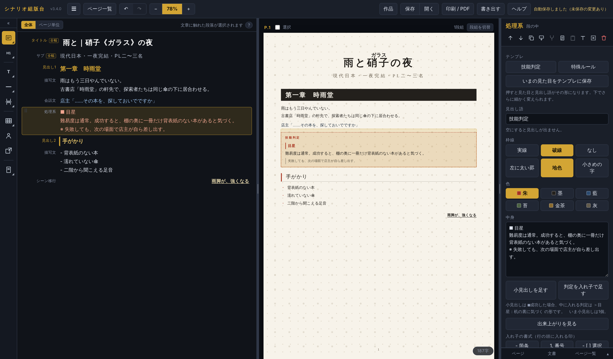

# シナリオ組版台

TRPG のシナリオを **書きながら、そのまま本の形に組む** ための道具です。

HTML ファイルが 1 つあるだけで動きます。インストールも、アカウント登録も、
サーバーとのやりとりもありません。原稿はあなたの手元から出ません。

左に原稿、右に紙面。打った字がそのまま、A4 の組み上がりとして隣に出ます。

---

## 使いかた

### ブラウザでそのまま開く

**<https://sedn14636361.github.io/trpg-scenario-editor/>**

開くだけで使えます。原稿はこのページを開いたブラウザの中にだけ置かれ、どこにも送られません。

> シナリオの置き場は「どこから開いたか」で分かれます。ダウンロードしたファイルで書いたシナリオは、
> この Web 版の一覧には出ません（逆も同じです）。移すときは、元の側で **保存**（`.json`）して、
> もう一方で **シナリオ** の画面の **JSONを読み込む** を使ってください。

### ダウンロードして使う

1. [`trpgscenarioeditor.html`](trpgscenarioeditor.html) を右クリックして保存する
   （または画面上の緑の **Code** → **Download ZIP**）
2. 保存したファイルをダブルクリックして、ブラウザで開く

それだけです。ローカルサーバーも、ビルドも要りません。

推奨ブラウザは **Chrome / Edge**（Chromium 系）です。Firefox・Safari でも書けますが、
印刷の改ページの位置がずれることがあります。

---

## できること

### 画面の並び

左から **書式ツールバー・原稿・紙面・プロパティ等** の順に並びます。
原稿と紙面をできるだけ広く取り、たまにしか触らない設定は奥にしまってあります。

| 場所 | 内容 |
|---|---|
| 左：書式ツールバー | 書式のアイコン。押すと内容が開き、もう一度押すと閉じる。`«` で細い帯にしまえる |
| 左下：ドキュメント設定／ページ一覧 | ツールバーのいちばん下のアイコン。押すと原稿欄の左に引き出しが開き、もう一度押すと閉じる |
| 右：段落の設定 | 段落を選んでいるときだけ出る。右上の `×` か `Esc` で閉じる（選択が外れる）。選んだ段落の設定と、段落の操作（上へ・下へ・複製・削除など） |

境目をつかむと原稿・紙面・プロパティ等の幅が変わります。

### 段落の書式

左の書式ツールバーで選びます。関連の近い書式を 1 つのアイコンにまとめてあり、
押すと内容が横に開きます。`Ctrl` + `Shift` + 下のキーでも切り替わります。

| アイコン | 書式 | キー |
|---|---|---|
| 本文ブロック | 描写 / 会話 / 注釈 / 処理（囲み） / 情報 | `0` `4` `5` `6` `L` |
| 見出しブロック | 見出し1〜3 / シーン移行 | `1` `2` `3` `8` |
| 区切りブロック | 罫線 / 縦線 / 改ページ / 改段 | `H` `V` `B` `D` |
| 図表ブロック | 画像 / 表 / フローチャート | `G` `X` `F` |
| シートブロック | NPCシート / ハンドアウト | `9` `Y` |
| 新規ウィンドウの追加 | 新規ウィンドウ | `W` |
| 装丁ブロック | 表紙 / 目次 / 奥付 | `C` `M` `K` |
| 表題ブロック | タイトル / サブタイトル | `T` `S` |

罫線・縦線・改ページ・改段・目次・画像・フローチャート・表・NPCシート・新規ウィンドウは段落の文字を使わないので、
文字の書いてある段落を選んでいるときは、その段落を変えずにすぐ下へ新しく足します。
選んでいる段落が空っぽなら、その段落が変わります。

「処理」は判定などをくくる囲みで、枠線の形・左の太罫・地色・文字の大きさ・
色（朱・墨・藍・苔・金茶・灰）を選べます。

### 入れ子の書式（行の頭の印）

本文の中では、行の頭に印を置くと見た目が変わります。markdown と同じ書き方も通ります。

| 印 | なるもの | 打ちやすい合図 |
|---|---|---|
| `- ` | 箇条書き | `/kajou` `/list` |
| `1. ` | 番号つき | `/bangou` `/num` |
| `- [ ] ` | 選択肢（`- [x]` で済みの印） | `/sentaku` `/check` |
| `  - ` | 1つ内側の箇条書き | `/sagedan` `/indent` |
| `■` | 囲みの中の小見出し | `/midashi` `/head` |
| `◇` | ひとまわり小さい小見出し | `/komidashi` `/sub` |
| `※` | 注釈 | `/chushaku` `/note` |
| `> 技能：` | 判定の枠 | `/hantei` `/roll` |
| `「」` | 会話（`名前「…」`で話し手つき） | `/kaiwa` `/talk` |
| `｜項目｜内容｜` | 表 | `/hyou` `/table` |
| `＠` | 新規ウィンドウを開くボタン | `/betsumado` `/pop` |

`■` や `◇` は打つのが手間なので、行の頭で `/` を打つと **候補の一覧** が出ます。
`↑` `↓` で選んで `Enter` か `Tab` で入ります。続けて打つと絞り込めます
（`/ko` → 小見出し、`/みだし` → 見出し・小見出し）。日本語入力のままなら全角の `／` でも出ます。
`/komidashi` のように最後まで打って空白を押しても、その場で印に化けます。
化けたあとの原稿はふつうの印そのものなので、紙面・書き出し・表の出力・文字数のどれにも影響しません。

### 情報ブロックとハンドアウト

**情報ブロック** はプレイヤーに渡す情報をまとめる枠です。
出力した HTML では枠を **クリックするだけで本文だけ** をコピーできるので、セッション中にチャットへそのまま貼れます。

**ハンドアウト** はハンドアウト番号（HO1）・ハンドアウト名・本文を持つ枠です。同じくクリックでコピーできます。
ハンドアウト番号はそのまま変数 `{HO1}` になります。

### 変数（`{HO1}` など）

本文などに `{HO1}` と書いておくと、**出力した HTML で入れた名前に置き換わります**。
HTML の左に「登場人物（変数）」の欄が出て、そこに「佐藤 千景」と入れれば、文中の `{HO1}` がすべてその名前になります
（入れた値はブラウザに覚えさせます）。

- `{HO1}` `{HO2}` のような **HO＋数字** は、ハンドアウトの枠がなくても書くだけで使えます
- それ以外の名前（`{KP}` など）は、左下の「ドキュメント設定」の **変数** の欄で登録したものだけが置き換わります。
  ココフォリアの `{SAN}` のような書き方は、登録しなければそのまま残ります
- ドキュメント設定の変数の欄で、すべての変数の名前・既定値・説明を直せます。ハンドアウトの変数は、ハンドアウトのプロパティでも直せます
- 編集画面の紙面でも、出力した HTML を開いた直後と同じ表示（既定値。なければ `HO1` のような名前）で見えます

### ルビ

`｜漢字《かんじ》` と書くと、ルビが振れます。`Ctrl` + `Shift` + `R` でも入ります。
見出し・会話・画像の説明文など、文字が出るところならどこでも使えます。

### 表

行と列を足し引きでき、升目の中に段落をそのまま入れられます（表の中に囲みや箇条書きが置けます）。
表からは **ココフォリアのロール表** の文字列も出せます。

### フローチャート

箱を置いて線でつなぐ、分かれ道つきの図です。Figma のように自由に配置でき、
箱の形（四角・角丸・ひし形・端子・入出力）、大きさ、二段分け、余白、色を選べます。
複数まとめて選んで、中央ぞろえ・横幅そろえ・余白均等がかけられます。

### 新規ウィンドウ

紙面には出さず、ボタンから開く補足のページを作れます。
NPC の裏設定、ハンドアウト、GM だけが読む注記などに使えます。
印刷と書き出しでは、巻末に「追記」としてまとめて付きます。

### NPC シート

名前・肩書き・能力値・技能などをまとめた囲みです。立ち絵も置けます。
**ココフォリアのコマ**を貼り付けて読み込むことも、逆にコマとして書き出すこともできます。

### 目次

何を載せるか（タイトル・見出し1〜3・サブタイトル・シーン移行）を書式ごとに選べます。
さらに見出し 1 つずつに、

- 目次に出る文字（見出し本体とは別に決められます）
- 載せる／載せない（書式ごとの設定を上書きします）
- 目次での段さげ

を持たせられます。ページ番号と点線は出し入れできます。

目次ブロックは **載せる範囲** を「全体」か「この章だけ」から選べます。「この章だけ」は、
すぐ上の見出し1から次の見出し1の手前までの見出しを載せるので、章ごとの細かい目次が作れます。
見出し1を選んで「装丁ブロック → 目次」を押すと、その章の頭に章の目次が入ります。

### 紙面

- ページごとに 1 段組／2 段組
- 余白（天地・左右）と基準の文字の大きさ
- 表紙ページと奥付ページ
- ノンブル（ページ番号）と柱（決まり文句）、始まりの番号
- 紙の色（ページごと。色のボタン10色・雰囲気からのおまかせ・好きな色。文字とのコントラスト比 7:1 を下回る色は自動で明るくする）。区切りなしの出力では、ページごとの色を上から順にグラデーションでつなぐ
- 背景の柄（無地・方眼・ドット・古紙・和紙・飾り枠・四隅の飾り・上下の帯）。本文の下はごく薄く、飾りは余白の中だけ。区切りなしの出力では画面や本文の欄に合わせて出す
- ページ一覧（`Ctrl` + `Shift` + `P`）。左の引き出しに 1 ページずつ出し、`▲` `▼` で切り替える。そのページの見出しも並び、押すとそこへ飛ぶ

---

## 保存と書き出し

| | |
|---|---|
| **自動保存** | 打つたびにブラウザの中に控えます（打ち終えて 0.7 秒、打ち続けていても 3 秒ごと）。閉じても次に開けば続きから |
| **シナリオ** | シナリオをいくつでもブラウザの中に置いておけます。一覧から開く・新しく作る・JSONを読み込む・複製・過去の版・削除（ゴミ箱） |
| **保存**（`Ctrl` + `S`） | `.json` ファイルとして手元に残します。これが原稿の本体です。Chrome / Edge では以後、自動保存のたびにそのファイルにも書きます |
| **印刷 / PDF** | ブラウザの印刷画面から PDF にできます |
| **HTML** | 配布用の**閲覧 HTML** を 1 ファイルで出力します。渡された人は開くだけで読めます。形式は **ページごと**（A4 を並べる。目次から飛ぶとそのページの頭から見える）か **区切りなしの1枚**（画面ぜんたいが紙。目次・章の目次・新規ウィンドウへ飛んで「↩ 戻る」で戻れる）を選べます |

起動するとシナリオの一覧が出ます。最後に開いていたシナリオが選ばれているので、
そのまま **開く**（または `Enter`）で続きから書けます。

### 原稿を失わないために

| しくみ | 守るもの |
|---|---|
| 閉じる瞬間の控え | タブを閉じる・再読み込みする瞬間に保存しきれなかった分を控え、次に開いたときに戻します |
| 3 秒ごとの保存 | 打ち続けていても 3 秒ごとに書くので、ブラウザがいきなり落ちても、消えるのは最後の数秒分までです |
| 1 シナリオ 1 タブ | 同じシナリオは 1 つのタブでしか開けません（「別のタブで編集中」）。2 つのタブで上書きし合うことがありません |
| 過去の版 | シナリオごとに、開いたとき・書いているあいだ 10 分ごと・「全部消して最初から」の直前の姿を 10 個まで残します |
| ゴミ箱 | 削除したシナリオは 30 日のあいだ戻せます |
| 失敗の帯 | 保存に失敗すると、画面の上に赤い帯が出て、直るまで消えません |
| ファイルへの自動保存 | Chrome / Edge では、はじめの **保存** で選んだファイルにも自動で書きます。ブラウザのデータが消えても、そのファイルから戻せます |

> シナリオはブラウザの IndexedDB に置きます。ブラウザのデータを消すとシナリオも消えるので、
> 大切な原稿は **保存** でファイルにも残してください（Chrome / Edge なら一度選べば以後は自動です）。
>
> v3.1 までの自動保存は、はじめて v3.2 以降を開いたときにシナリオとして引き継ぎます。
> 引き継いだあとは古い保存場所から消すので、古い版の組版台ではその原稿が見えなくなります
> （消す前に確認が出ます）。
>
> IndexedDB が使えないブラウザでは、これまでどおり 1 シナリオだけを保存します。
> その場合は画像やフォントで自動保存の容量（4MB）を超えることがあり、画面下に知らせが出ます。

---

## 覚えておくと早いキー

| キー | すること |
|---|---|
| `Ctrl` + `Shift` + 書式のキー | 選んだ段落の書式を変える |
| `Ctrl` + `Z` / `Ctrl` + `Y` | 元に戻す / やり直す |
| `Ctrl` + `S` | ファイルに保存 |
| `Ctrl` + `C` / `Ctrl` + `V` | 段落まるごとコピー・貼り付け（文字を選んでいないとき） |
| `Ctrl` + `Alt` + `Shift` + `C` / `V` | 同じことを確実に |
| `Ctrl` + `Shift` + `R` | ルビを振る |
| `Ctrl` + `Shift` + `[` / `]` | 字下げを戻す / 下げる |
| `Ctrl` + `Shift` + `P` | ページ一覧 |
| `Ctrl` + `0` | 紙面を幅に合わせる |
| `Ctrl` + `+` / `-`、`Ctrl` + `Shift` + `↑` `↓` | 紙面を大きく / 小さく |
| `Ctrl` + ホイール | 同じく大きく / 小さく |
| `Esc` | 選択を外す |

画面右上の **ヘルプ** に、もっと詳しい説明が入っています。

---

## 内容について

- 素の HTML / CSS / JavaScript だけで書かれた **1 ファイル**です。
  ビルドも、外部のライブラリも、通信もありません。
- 紙面の見た目を決める CSS は `DOC_CSS`（JavaScript の中の文字列）に集めてあり、
  編集画面と書き出し HTML の両方がこれを使います。だから**画面と書き出しが食い違いません**。
- フローチャートは、形と線を SVG で、文字を mm 指定の HTML で重ねて描いています。
- コメントは日本語で、「なぜそうしたか」を残す形で書いてあります。

直したいところがあれば、ブラウザで開いてそのまま読めます。

---

## 版

画面右上に出ている文字が、いま動いている版です。
不具合を知らせてくださるときは、この文字も一緒に教えてください。

**いまの版：v3.13.1**

---

## ライセンス

[CC0 1.0 全世界](LICENSE)（パブリックドメイン）。

著作権を放棄しています。**表示も断りもなしに**、自由に使い、書き換え、
配ってかまいません。商用でも、あなたの卓のためだけでも、同じです。
